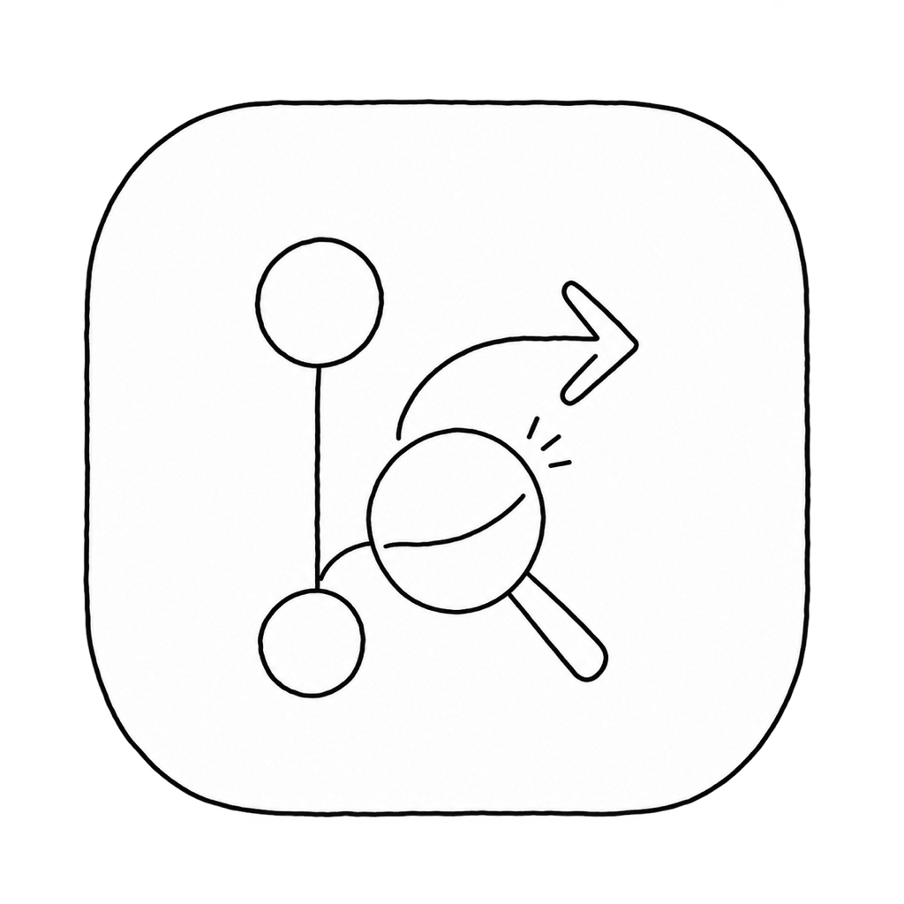

# GitHub Toolbox

A macOS menu bar app for the pull requests that are waiting on you.



The menu bar shows a count of PRs that need your review. Click it for a two-pane window:

- **Review requested**: open PRs where your review is requested, with CI state, author, reviewers and their latest verdict. Approve, request changes or close without leaving the window.
- **My PRs**: your open PRs, showing who is reviewing them (or that nobody is yet). Request a reviewer from GitHub's suggestions, flip between draft and ready for review.
- **Agent pre-review**: for each PR waiting on you, the app checks the head out into a throwaway worktree and asks [Codex](https://github.com/openai/codex) (read-only sandbox) or [Claude Code](https://claude.com/claude-code) (read-only tools only) for a structured verdict. Pick which one from the gear menu at the bottom of the window. The verdict is `ok`, or a list of file/line concerns a careful reviewer must look at. Findings can be posted to the PR as a changes-requested review with one click. If the repo has a `docs/review-rules.md`, the reviewer applies it.

Refreshes every 90 seconds. Closed, approved and reviewed PRs drop off the list straight away.

## Requirements

- macOS 14 or later
- [`gh`](https://cli.github.com) signed in (`gh auth login`). All GitHub access goes through it, so the app holds no token of its own.
- For the pre-review, whichever engine you pick, signed in: [`codex`](https://github.com/openai/codex) or [`claude`](https://claude.com/claude-code) (looked up in Homebrew's bin and `~/.local/bin`). Everything else works without either.
- Xcode command line tools (for `swift build`)

## Install

```sh
./build.sh
```

Builds a release binary, wraps it in `GitHub Toolbox.app` (menu bar agent, no Dock icon), ad-hoc signs it and copies it to `/Applications`.

Review clones and worktrees live under `~/Library/Application Support/GHToolbox/` and are cleaned up after each review.
